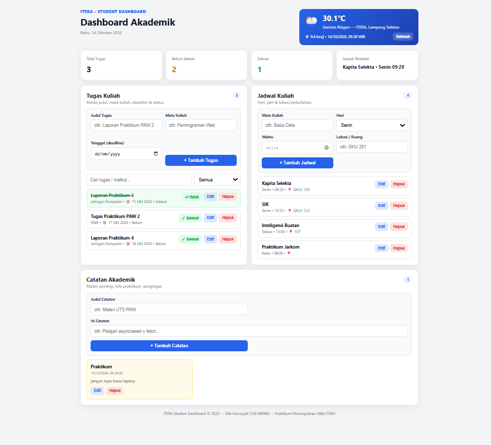

# ITERA Student Dashboard — Tugas Pertemuan 2

## Identitas

* **Nama:** Diki Hurrisyail
* **NIM:** 124140088
* **Mata kuliah:** Praktikum Pemrograman Aplikasi Web (PAW) ITERA
* **Folder:** `dikihurrisyail_124140088_pertemuan2/tugas/`

## Deskripsi

Personal dashboard untuk mahasiswa mengelola tugas kuliah, jadwal kuliah, catatan akademik, dan kutipan motivasi harian. Data tersimpan di `localStorage`, kutipan diambil dari DummyJSON Quotes API.

Endpoint kutipan inspirasi harian (tanpa API key):

```text
https://dummyjson.com/quotes/random
```

## Cara Menjalankan

1. Buka folder `dikihurrisyail_124140088_pertemuan2/tugas/` di VS Code.
2. Klik kanan `index.html` → **Open with Live Server** (atau double-click untuk `file://`).
3. Tambah tugas / jadwal / catatan, klik Kutipan Baru untuk inspirasi lain.

## Struktur Folder

```text
tugas/
├── index.html   # struktur dashboard
├── style.css    # layout + responsif
├── app.js       # logika ES6+ (TaskItem, DashboardApp)
└── README.md
```

## Fitur (sesuai PRD)

* [x] Header + tanggal hari ini (`renderToday`)
* [x] Widget kutipan async (DummyJSON `quotes/random`: kutipan + penulis) + tombol Kutipan Baru + fallback offline
* [x] Ringkasan: total / belum / selesai / jadwal terdekat
* [x] Tugas: tambah, edit, hapus, toggle selesai, cari + filter, validasi
* [x] Jadwal: tambah, edit, hapus (matkul, hari, waktu, lokasi), auto-sort hari+jam
* [x] Catatan: tambah, edit, hapus + timestamp
* [x] localStorage: `itera_tasks`, `itera_schedules`, `itera_notes`
* [x] Toast sukses / error, konfirmasi hapus
* [x] Responsif desktop + ponsel (`@media 900px & 560px`)

## Implementasi ES6+ (lokasi di `app.js`)

| Fitur | Lokasi |
|---|---|
| `let` dan `const` | `STORAGE_KEYS`, `QUOTE_URL`, `DAY_ORDER`, semua state di `DashboardApp` (`app.js:3-12`) |
| Arrow functions | `uid`, `loadData`, `saveData`, `escapeHtml`, `fmtDateID`, `toast`, semua `.map/.filter/.sort`, handler `addEventListener((e) => ...)` (`app.js:15-58`, `bindEvents`) |
| Template literals | `renderTasks`, `renderSchedules`, `renderNotes` — bangun HTML dinamis dengan `` `...${...}` `` (`app.js:renderTasks/renderSchedules/renderNotes`) |
| Async/await + Fetch | `async loadQuote()` — `await fetch(QUOTE_URL)`, `await res.json()`, try/catch offline (`app.js:loadQuote`) |
| Classes | `class TaskItem` (constructor, `toggle()`, getter `summary`) dan `class DashboardApp` (CRUD + render + persist) (`app.js:60-90`) |
| Destructuring | `const { action, id } = btn.dataset`, `const { quote, author, id } = data`, `map(({ id, title, ... }) => ...)` |
| Spread operator | `[...this.tasks, item]`, `[...this.schedules, {...}]`, `{ ...t, title, ... }` saat edit (imutabel) |

## Screenshot



## Kriteria Keberhasilan

1. CRUD tugas/jadwal/catatan jalan tanpa reload. ✅
2. Data awet setelah refresh (localStorage). ✅
3. Ringkasan update otomatis. ✅
4. Kutipan tampil saat online, fallback saat offline. ✅
5. Semua ES6+ wajib dipakai (tabel di atas). ✅
6. Responsif. ✅
