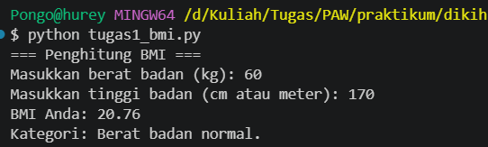
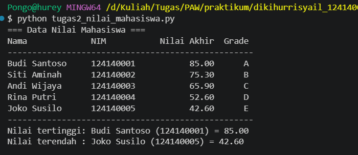
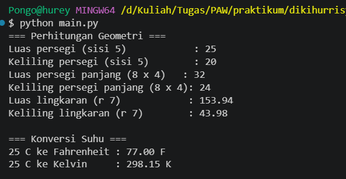

# Praktikum 4 - Dasar Pemrograman Python

## Identitas Mahasiswa

- Nama: Diki Hurrisyail
- NIM: 124140088

## Deskripsi Program

### 1. Tugas 1 - Penghitung BMI

File `tugas1_bmi.py` menghitung Indeks Massa Tubuh (BMI).

- Pengguna memasukkan berat badan (kg) dan tinggi badan (meter) lewat `input()`.
- Program menolak tinggi badan yang bernilai nol atau negatif.
- BMI dihitung dengan rumus `berat / (tinggi * tinggi)`.
- Percabangan `if-elif-else` menentukan kategori:
  - BMI < 18.5: Berat badan kurang.
  - 18.5 sampai di bawah 25: Berat badan normal.
  - 25 sampai di bawah 30: Berat badan berlebih.
  - BMI 30 ke atas: Obesitas.
- Hasil BMI ditampilkan dengan 2 angka desimal memakai f-string.

### 2. Tugas 2 - Pengelolaan Data Nilai Mahasiswa

File `tugas2_nilai_mahasiswa.py` mengolah nilai 5 mahasiswa.

- Data disimpan dalam list yang berisi dictionary (`nama`, `nim`, `nilai_uts`, `nilai_uas`, `nilai_tugas`).
- Nilai akhir dihitung dengan rumus `(30% * UTS) + (40% * UAS) + (30% * Tugas)`.
- Grade ditentukan dari nilai akhir: A (>= 80), B (>= 70), C (>= 60), D (>= 50), E (< 50).
- Perulangan `for` memproses seluruh mahasiswa dan menampilkan tabel di terminal.
- Program juga mencari dan menampilkan mahasiswa dengan nilai akhir tertinggi dan terendah.

### 3. Tugas 3 - Modul Matematika

File `math_operations.py` berisi konstanta `PI = 3.14159` dan fungsi:

- `luas_persegi` dan `keliling_persegi`
- `luas_persegi_panjang` dan `keliling_persegi_panjang`
- `luas_lingkaran` dan `keliling_lingkaran`
- `celsius_ke_fahrenheit` dan `celsius_ke_kelvin`

File `main.py` memakai modul itu dengan dua cara impor:

- `import math_operations`
- `from math_operations import ...`

Semua fungsi dipanggil dengan nilai uji, lalu hasilnya ditampilkan di terminal.

## Instruksi Menjalankan Program

Buka terminal VS Code di folder proyek, lalu jalankan perintah berikut.

Mengaktifkan virtual environment (Windows PowerShell):

```powershell
.\venv\Scripts\Activate
```

Menjalankan Tugas 1:

```bash
python tugas1_bmi.py
```

Menjalankan Tugas 2:

```bash
python tugas2_nilai_mahasiswa.py
```

Menjalankan Tugas 3:

```bash
python main.py
```

Menonaktifkan virtual environment:

```bash
deactivate
```

## Screenshot Bukti Eksekusi

### Screenshot Tugas 1



### Screenshot Tugas 2



### Screenshot Tugas 3


