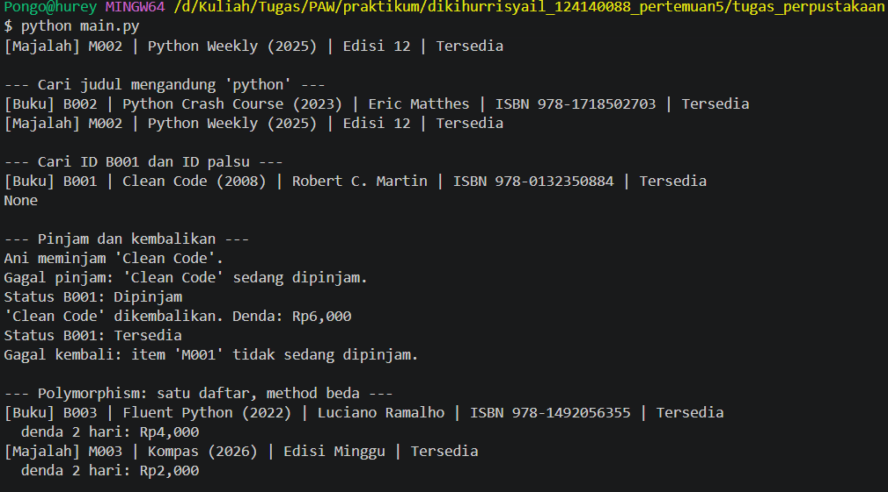

# Sistem Manajemen Perpustakaan Sederhana

- Nama: Diki Hurrisyail
- NIM: 124140088
- Kelas praktikum: RB

## Deskripsi

Program OOP sederhana untuk katalog perpustakaan. Menyimpan buku dan majalah, mencari item, meminjam, mengembalikan, dan menghitung denda. Hanya memakai library bawaan Python (`abc`). Tidak ada dependency eksternal.

## Empat pilar OOP

1. **Class & Object** — `Library`, `Member`, `Book`, dan `Magazine` adalah class. Objek dibuat di `main.py` (contoh: satu objek `Library`, beberapa `Book`).
2. **Inheritance** — `Book` dan `Magazine` mewarisi `LibraryItem`. Method umum (`status`, `dipinjam`) ada di induk.
3. **Encapsulation** — Data sensitif disimpan private (`__dipinjam`, `__koleksi`, `__id`, `__nama`) dan diakses lewat `@property`. Setter menolak nilai yang tidak valid.
4. **Polymorphism** — `get_detail()` dan `hitung_denda()` dideklarasikan abstract di `LibraryItem`, lalu diisi berbeda oleh `Book` (denda Rp2.000/hari) dan `Magazine` (denda Rp1.000/hari). Pemanggil cukup memakai tipe induk.

## Struktur folder

```text
dikihurrisyail_124140088_pertemuan5/
├── latihan_oop/            # materi latihan
├── tugas_perpustakaan/
│   ├── library_item.py     # ABC LibraryItem, Book, Magazine
│   ├── member.py           # class Member
│   ├── library.py          # class Library
│   └── main.py             # demo program
├── venv/                   # environment lokal
├── README.md
└── .gitignore
```

## Virtual environment (Windows PowerShell)

Dibuat sekali di folder utama project:

```powershell
python -m venv venv
.\venv\Scripts\Activate.ps1
python --version
```

Kalau `venv` sudah ada, jangan buat ulang. Langsung aktifkan:

```powershell
.\venv\Scripts\Activate.ps1
```

## Menjalankan program

Dari folder utama project:

```powershell
# Aktivasi virtual environment
.\venv\Scripts\Activate.ps1

# Masuk ke folder tugas
cd tugas_perpustakaan

# Jalankan program
python main.py
```

## Screenshot output


